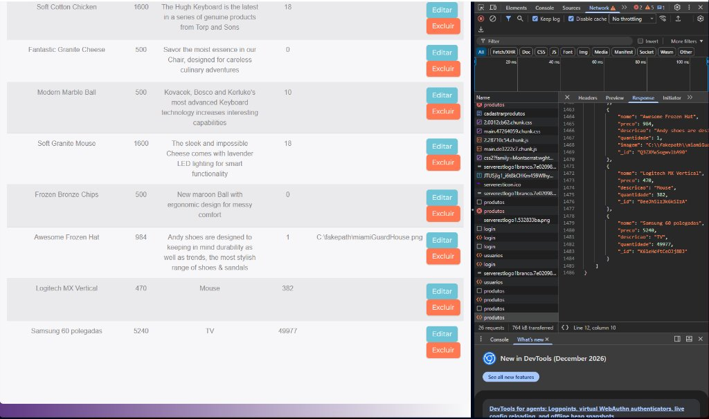
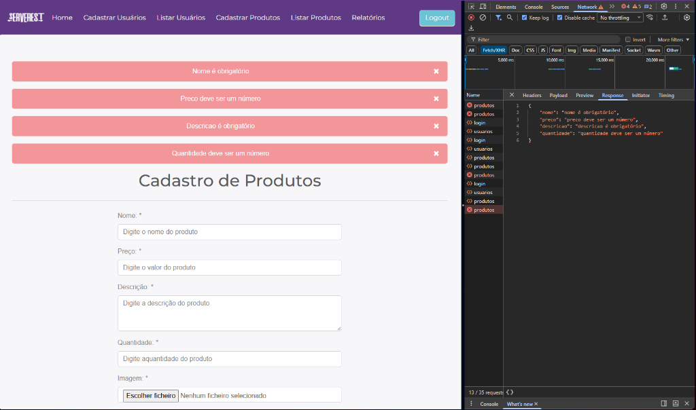
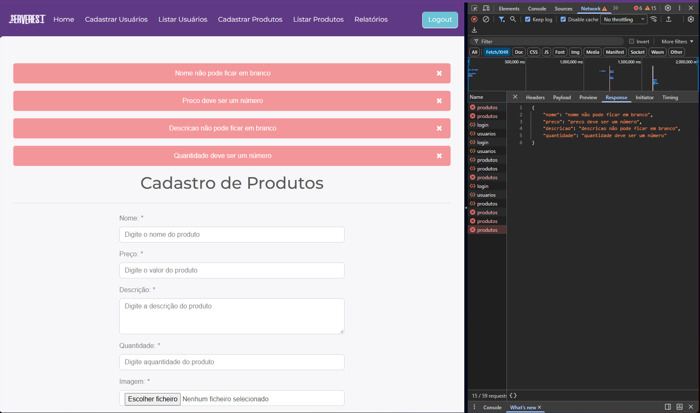
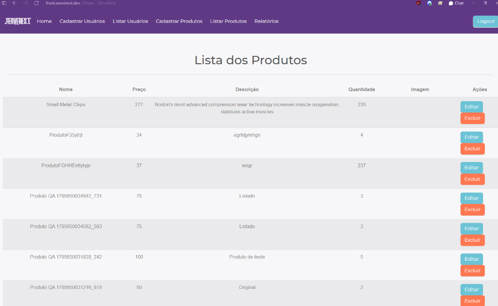

# Relatório de Bugs — ServeRest

Este documento reúne quatro problemas e pontos de melhoria encontrados durante a exploração e automação de testes da gestão de produtos no ServeRest (`https://front.serverest.dev` e `https://serverest.dev`).

---

## 1. Campo `imagem` aceito na API de cadastro, mas ausente na documentação

**Ambiente**  
API `https://serverest.dev` e documentação Swagger (`https://serverest.dev/swagger.json`). Observado em 24/11/2026.

**Pré-condições**  
Ter um usuário administrador autenticado na API.

**Passos para reproduzir**
1. Abrir a documentação da API (`https://serverest.dev/swagger.json`) e verificar os campos aceitos no cadastro de produtos (`POST /produtos`).
2. Enviar uma requisição de cadastro (`POST /produtos`) incluindo o campo `imagem` no corpo:
   ```json
   {
     "nome": "teclado teste",
     "preco": 150,
     "descricao": "teste",
     "quantidade": 2,
     "imagem": "imagem-produto.png"
   }
   ```
3. Consultar o produto criado em `GET /produtos/{id}`.

**Resultado obtido**  
A API aceita o campo `imagem`, cria o produto normalmente (`201`) e passa a retornar esse campo na listagem. Porém, na documentação do Swagger só aparecem `nome`, `preco`, `descricao` e `quantidade` — o campo `imagem` não está documentado em lugar nenhum e o contrato indica que campos extras não seriam aceitos. Esse comportamento está coberto pelo teste `test.fail` `Validar que o Swagger documenta o campo imagem aceito em POST /produtos` em `tests/api/produtos.api.spec.ts`.

**Resultado esperado**  
A documentação e o comportamento da API devem caminhar juntos: se o campo `imagem` é aceito, ele precisa aparecer no Swagger com suas regras; se não deveria existir, a API deveria rejeitá-lo com erro `400`.

**Impacto**  
Quem integra com a API seguindo a documentação oficial não fica sabendo que o campo `imagem` existe, o que gera surpresas e desconfiança no contrato.

**Severidade e prioridade**  
Média / Média — não impede o cadastro de produtos, mas deixa a documentação desatualizada em relação ao que a API faz de verdade.

---

## 2. Listagem de produtos sem paginação (melhoria)

**Ambiente**  
Frontend `https://front.serverest.dev`, Google Chrome, Windows 11. Observado em 24/11/2026.

**Pré-condições**  
Estar logado como administrador e haver vários produtos cadastrados no ambiente.

**Passos para reproduzir**
1. Fazer login como administrador em `https://front.serverest.dev/login`.
2. Acessar a tela **Listar Produtos** (`/admin/listarprodutos`).
3. Rolar até o final da tabela e observar a resposta da requisição de listagem.

**Resultado obtido**  
Todos os produtos cadastrados no ambiente são carregados e exibidos de uma só vez em uma tabela muito longa, sem nenhum controle de paginação. No momento do teste, uma única chamada trouxe mais de 1.480 linhas de dados de uma vez.



**Resultado esperado**  
A tabela deveria ser dividida em páginas (por exemplo, 10 ou 20 produtos por página), com botões para avançar e voltar entre elas.

**Impacto**  
Conforme o catálogo cresce, fica cansativo encontrar um produto na tela e o carregamento da página tende a ficar cada vez mais pesado.

**Severidade e prioridade**  
Baixa / Baixa — é uma melhoria de experiência de uso; nenhuma função está quebrada, mas o uso no dia a dia fica prejudicado com muitos itens.

---

## 3. Mensagens de erro diferentes para campos vazios no cadastro de produtos

**Ambiente**  
Frontend `https://front.serverest.dev` e API `https://serverest.dev`, Google Chrome, Windows 11. Observado em 24/11/2026.

**Pré-condições**  
Estar logado como administrador na tela **Cadastrar Produtos** (`/admin/cadastrarprodutos`), com o formulário limpo.

**Passos para reproduzir**

*Cenário A — enviar sem preencher nada:*
1. Clicar diretamente em **Cadastrar** sem tocar nos campos.

*Cenário B — preencher e apagar preço e quantidade:*
1. Digitar `5` no campo **Preço** e apagar o valor. Fazer o mesmo no campo **Quantidade**.
2. Deixar **Nome** e **Descrição** sem tocar.
3. Clicar em **Cadastrar**.

*Cenário C — preencher e apagar todos os campos:*
1. Digitar qualquer valor em **Nome**, **Preço**, **Descrição** e **Quantidade**, depois apagar tudo.
2. Clicar em **Cadastrar**.

| Campo | Sem tocar (A) | Depois de digitar e apagar (B / C) |
| --- | --- | --- |
| Nome | "Nome é obrigatório" | "Nome não pode ficar em branco" |
| Preço | "Preco é obrigatório" | "Preco deve ser um número" |
| Descrição | "Descricao é obrigatório" | "Descricao não pode ficar em branco" |
| Quantidade | "Quantidade é obrigatório" | "Quantidade deve ser um número" |

Isso acontece porque, quando um campo é preenchido e apagado, a tela passa a enviá-lo como texto vazio (`""`) em vez de omiti-lo, e a API devolve mensagens diferentes para cada caso. Esse comportamento está coberto nos testes E2E de `tests/e2e/produtos.e2e.spec.ts` (`Deve apresentar os erros de campo obrigatório ao enviar o formulário vazio` e `Não deve cadastrar o produto quando preço e quantidade são preenchidos e apagados`).

*Cenário A — formulário enviado sem tocar nos campos:*


*Cenário B — preço e quantidade digitados e apagados:*



*Cenário C — todos os campos digitados e apagados:*



**Resultado esperado**  
Sempre que um campo obrigatório estiver vazio, a mensagem exibida deveria ser a mesma — `"<Campo> é obrigatório"` — independentemente de o usuário ter digitado e apagado antes. A mensagem `"deve ser um número"` deveria aparecer apenas quando alguém digitar um valor que não seja numérico.

**Impacto**  
Ver a mensagem `"Preco deve ser um número"` em um campo vazio confunde quem está usando a tela, já que nada inválido foi digitado. Também deixa a validação inconsistente entre os campos do mesmo formulário.

**Severidade e prioridade**  
Baixa / Baixa — o sistema continua impedindo o cadastro inválido e não há perda de dados, mas a comunicação com o usuário fica confusa.
---

## 4. Botão "Editar" na listagem de produtos não funciona

**Ambiente**  
Frontend `https://front.serverest.dev`, Google Chrome, Windows 11. Observado em 26/11/2026.

**Pré-condições**  
Estar logado como administrador e haver pelo menos um produto cadastrado na listagem.

**Passos para reproduzir**
1. Fazer login como administrador em `https://front.serverest.dev/login`.
2. Acessar a tela **Listar Produtos** (`/admin/listarprodutos`).
3. Na coluna **Ações** de qualquer produto, tentar clicar no botão **Editar**.

**Resultado obtido**  
O botão **Editar** aparece visível em todas as linhas da tabela (ao lado de **Excluir**), mas não responde ao clique: não abre nenhuma tela de edição, não exibe aviso e não faz nenhuma chamada para atualizar o produto.



**Resultado esperado**  
Ao clicar em **Editar**, o administrador deveria ser levado para uma tela de edição já preenchida com os dados do produto para poder atualizá-los — ou, se a funcionalidade ainda não estiver pronta, o botão não deveria aparecer como se estivesse disponível.

**Impacto**  
O administrador não consegue corrigir o preço, a descrição ou a quantidade de um produto já cadastrado pela interface; a única saída é excluir o item e cadastrá-lo de novo do zero.

**Severidade e prioridade**  
Média / Média — não impede cadastrar nem excluir produtos, mas bloqueia completamente a edição pela tela, mesmo com a API já oferecendo a rota de atualização (`PUT /produtos/{id}`).
